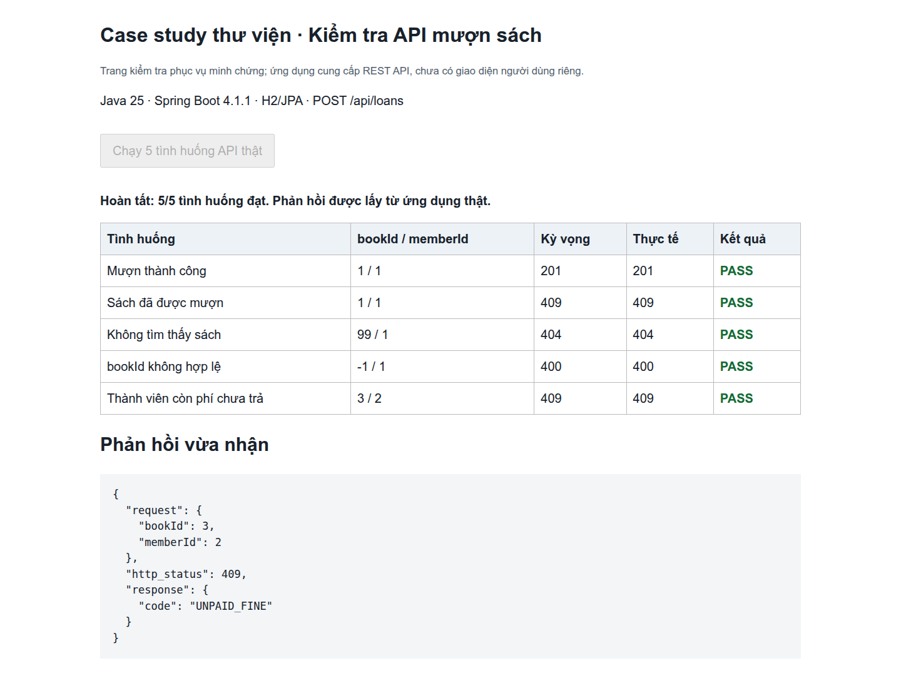
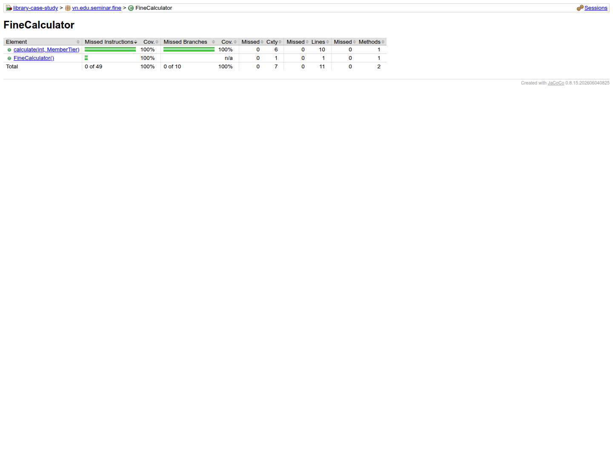
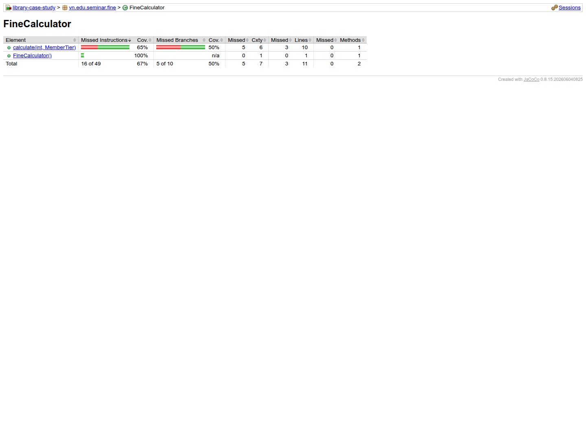
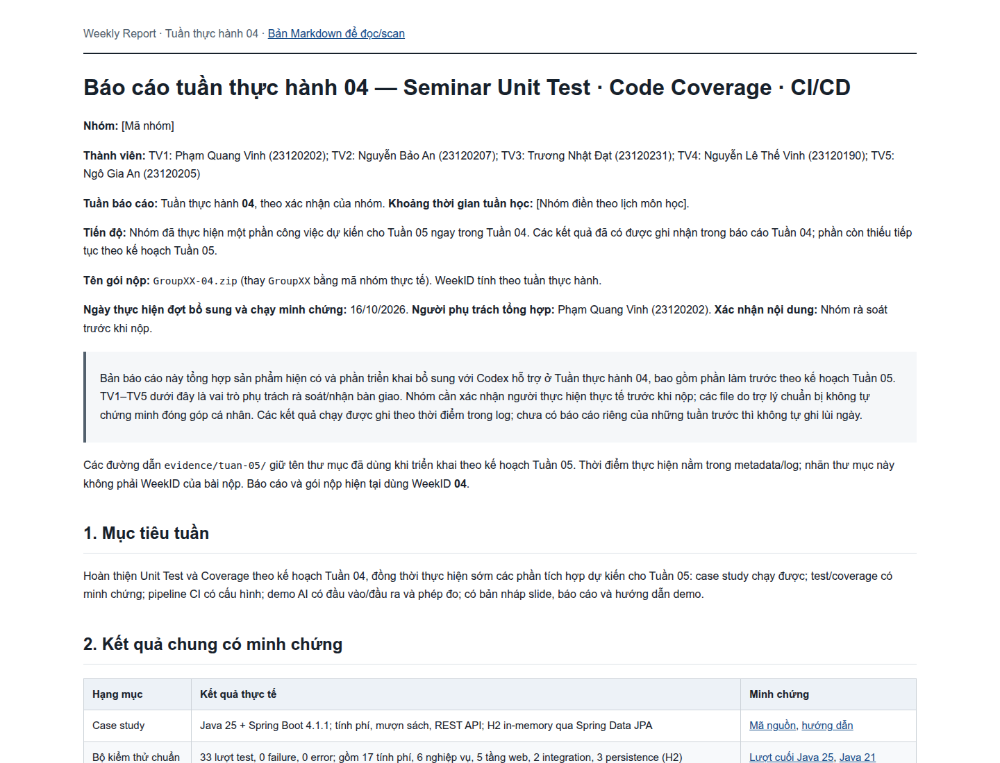
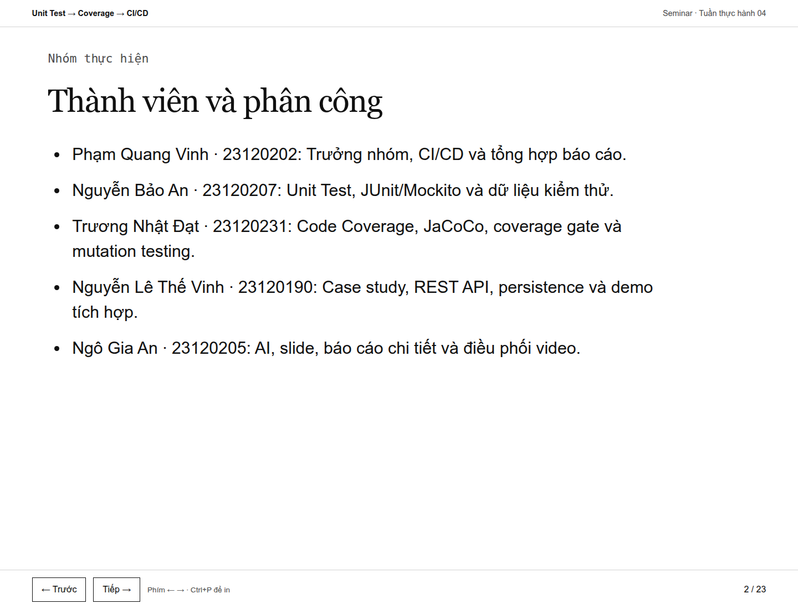

# Minh chứng Tuần thực hành 04

**Ngày thực hiện:** 16/10/2026. Gói tuần này chỉ dùng ảnh minh chứng theo yêu cầu nhóm, không kèm video.

## 1. Bảng kết quả đối chiếu từ log

| Nội dung | Kết quả | Dữ liệu gốc |
|---|---|---|
| Bộ kiểm thử chuẩn Java 25 | 33 lượt, 0 failure, 0 error | [Surefire và log](../evidence/tuan-05/final/) |
| FineCalculator trước/sau | Branch 50% → 100%; gate yêu cầu >=90% | [Baseline](../evidence/tuan-05/baseline/site/jacoco/index.html), [đầy đủ](../evidence/tuan-05/final/site/jacoco/index.html) |
| Mutation test yếu/đầy đủ | Diệt 3/11 và 10/11 mutant | [PIT yếu](../evidence/tuan-05/pit-weak/pit-reports/index.html), [PIT đầy đủ](../evidence/tuan-05/pit-strong/pit-reports/index.html) |
| Cache Maven lạnh/ấm | Đủ 3/3 cặp; trung vị 48,412/12,539 giây | [Số đo](../evidence/tuan-05/benchmark-cache/summary.json) |
| JaCoCo tắt/bật | Đủ 3/3 cặp; trung vị 9,727/12,754 giây | [Số đo](../evidence/tuan-05/benchmark-jacoco/summary.json) |
| API chạy lại để chụp ảnh | 5/5 tình huống trả đúng HTTP status và mã lỗi nghiệp vụ | [Request/response thật](../evidence/tuan-04-demo/results.json), [metadata](../evidence/tuan-04-demo/run.json) |

Các ảnh JaCoCo là ảnh chụp lại báo cáo từ các lượt chạy đã lưu, không phải chạy lại bộ test trong lúc chụp. Ảnh API dùng ứng dụng vừa đóng gói offline bằng Java 25; bước đóng gói có skipTests, kết quả bộ test lấy từ log riêng nêu trên. Trang kiểm tra API chuyển tiếp request tới REST API thật trên loopback, không giả lập phản hồi và không phải giao diện người dùng của sản phẩm. Các mã 400/404/409 là kết quả mong đợi của tình huống lỗi.

## 2. Ảnh API — 5 tình huống thực tế

Các mã trả về lần lượt: 201 (mượn thành công), 409 (sách đã mượn), 404 (không có sách), 400 (ID âm), 409 (còn phí chưa trả). Dữ liệu phản hồi và thời điểm UTC nằm trong results.json.

## 3. Ảnh JaCoCo — bộ đầy đủ

Chỉ kết luận 100% branch/line cho FineCalculator. Không suy ra 100% toàn ứng dụng hoặc test đã phát hiện mọi lỗi.

## 4. Ảnh JaCoCo — bộ baseline

Bộ baseline phủ 5/10 nhánh; log gate fail được lưu riêng tại evidence/tuan-05/gate-fail/.

## 5. Ảnh báo cáo đã điền thành viên

## 6. Ảnh slide phân công

Phân công theo yêu cầu nhóm; không dùng bảng phân công để gán tác giả các commit cũ. Timestamp chụp từng ảnh được lưu trong [screenshots.json](../evidence/tuan-04-demo/screenshots.json).
