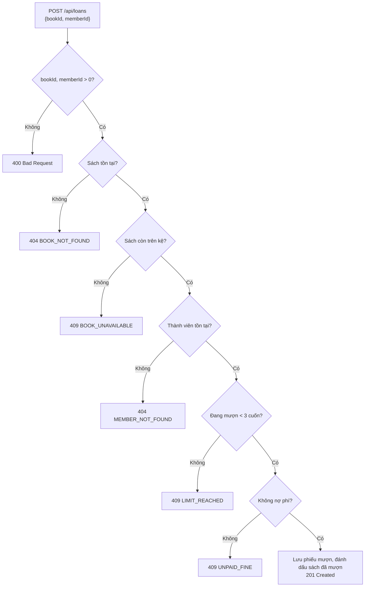
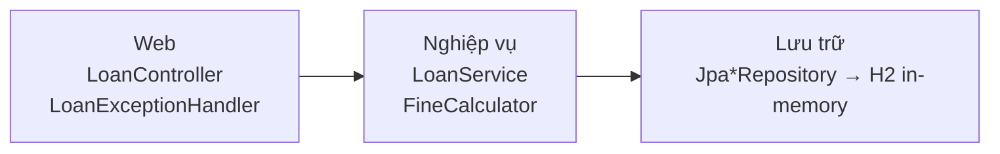

# Mô tả nghiệp vụ case study: ứng dụng quản lý thư viện

**Người phụ trách:** Nguyễn Lê Thế Vinh (23120190) · Dùng cho slide mở đầu (phần "Case study") và Video C.

## 1. Ứng dụng làm gì (một câu)

Thành viên gửi yêu cầu **mượn một cuốn sách**; hệ thống kiểm tra 5 điều kiện rồi **cho mượn (201)** hoặc **từ chối kèm lý do (404/409)**. Ngoài ra có một hàm **tính phí trả trễ** theo hạng thành viên.

## 2. Luồng mượn sách



Thứ tự kiểm tra đúng như trong `LoanService.borrow`. Khi bị từ chối, hệ thống **không lưu gì**: sách vẫn còn trên kệ, người khác mượn được (có test `LoanFlowEdgeCaseTest.muonBiTuChoiKhongKhoaSach`).

## 3. Quy tắc tính phí trả trễ (`FineCalculator`)

| Hạng | Ân hạn | Phí mỗi ngày sau ân hạn | Ví dụ |
|---|---|---|---|
| NORMAL | 0 ngày | 2.000đ | trễ 3 ngày → 6.000đ |
| VIP | 2 ngày | 1.000đ | trễ 3 ngày → 1.000đ |

- Phí tối đa **50.000đ** (NORMAL trễ 30 ngày → 50.000đ, không phải 60.000đ).
- Số ngày âm hoặc hạng rỗng → báo lỗi.

## 4. Kiến trúc (theo tầng, mỗi tầng một loại test)



| Tầng | Lớp chính | Loại test trong repo |
|---|---|---|
| Web | `LoanController`, `LoanExceptionHandler` | `LoanControllerTest` (MockMvc, service bị mock) |
| Nghiệp vụ | `LoanService`, `FineCalculator`, `LoanPeriodPolicy` | Unit test thuần + Mockito (`LoanServiceTest`, `FineCalculatorTest`) |
| Lưu trữ | `JpaBookRepository`, `JpaMemberRepository`, `JpaLoanRepository` | `JpaRepositoriesTest` (H2 thật) |
| Cả hệ thống | toàn bộ | `LoanFlowTest`, `LoanFlowEdgeCaseTest` (Spring Boot + H2) |

## 5. Dữ liệu mẫu (`data.sql`, nạp lại mỗi lần khởi động)

| Đối tượng | Trạng thái | Dùng để demo |
|---|---|---|
| Sách 1 | còn trên kệ | mượn thành công 201, mượn lại → 409 `BOOK_UNAVAILABLE` |
| Sách 2 | đã có người mượn | 409 `BOOK_UNAVAILABLE` ngay lần đầu |
| Sách 3 | còn trên kệ | thử với thành viên 2 |
| Thành viên 1 | không nợ | người mượn "chuẩn" |
| Thành viên 2 | nợ 5.000đ | 409 `UNPAID_FINE` |

Không có ở dữ liệu mẫu: sách/thành viên số 99 → dùng để demo 404.

## 6. Nội dung đề xuất cho slide (dán vào `slides/slides.json`)

Slide 4 hiện có đã nêu quy tắc. Đề xuất thêm một slide ngay sau đó, để người nghe thấy luồng trước khi vào phần test:

```json
{"stage": "Case study", "title": "Một yêu cầu mượn sách đi qua đâu?", "bullets": [
  "POST /api/loans → kiểm tra 5 điều kiện theo thứ tự: sách tồn tại, sách còn, thành viên tồn tại, < 3 cuốn, không nợ phí.",
  "Đạt hết → 201 và lưu phiếu mượn; trượt một điều kiện → 404/409 kèm mã lỗi, không lưu gì.",
  "3 tầng Web → Nghiệp vụ → Lưu trữ (H2), mỗi tầng một kiểu test: MockMvc, unit/Mockito, DataJpaTest.",
  "Video C: chạy ứng dụng và gửi từng request (xem kịch bản)."
]}
```
