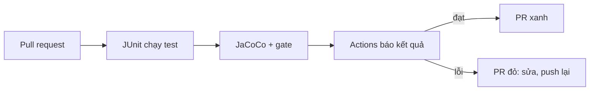
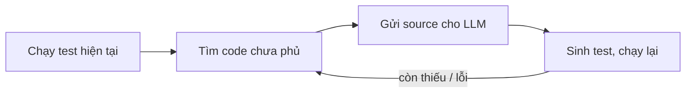
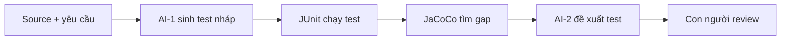

# Unit Test, Code Coverage <br> và CI/CD

Kiểm thử tự động với JUnit · JaCoCo · GitHub Actions

<div class="logos">
  
  
  
  
</div>

<!--
Mở đầu: một thay đổi nhỏ có thể làm hỏng chức năng đang chạy. Kiểm tra thủ công sau mỗi lần sửa thì tốn thời gian và khó lặp lại.
Unit Test biến các kiểm tra đó thành test chạy tự động. Bài tập trung vào Unit Test, Code Coverage, coverage gate trong CI/CD, với ba công cụ JUnit, JaCoCo, GitHub Actions.
-->

---
layout: statement
---

<p class="kicker">Câu hỏi chính</p>

# Test xanh và coverage 100% <br> có chắc chương trình đã đúng không?

<!--
Khi toàn bộ test đều xanh, ta vẫn chưa biết bộ test đã đi qua hết các nhánh hay chưa — Code Coverage trả lời phần đó. Từ coverage, nhóm tạo coverage gate để build thất bại nếu độ phủ dưới ngưỡng.
Đặt câu hỏi này cho khán giả, giữ lại câu trả lời đến cuối bài.
-->

---

# Unit Test là gì?

- Kiểm tra **một phần nhỏ**: hàm, phương thức, lớp
- Mỗi test kiểm tra **một hành vi**
- Phát hiện lỗi sớm, sửa code an toàn hơn
- **Không thay thế** integration test

<!--
Unit Test so sánh kết quả thực tế với kết quả mong đợi cho một đơn vị nhỏ. Phạm vi nhỏ để khi thất bại thì tìm nguyên nhân nhanh. Test phải khởi động cả ứng dụng, gọi nhiều dịch vụ, dùng DB thật thì không còn là Unit Test thuần.
Lợi ích: báo lỗi ngay khi thay đổi làm sai hành vi; refactor rồi chạy lại để kiểm tra hành vi cũ; tên test và assertion mô tả chương trình phải xử lý thế nào.
Integration test vẫn cần để xác nhận các thành phần thật kết nối đúng.
-->

---
class: code-lg
---

# Arrange · Act · Assert

```java
@Test void thuongTre3Ngay_tra6000() {
    var calculator = new FineCalculator();                  // Arrange
    var fine = calculator.calculate(3, MemberTier.NORMAL);  // Act
    assertThat(fine).isEqualByComparingTo("6000");          // Assert
}
```

<div class="mt-8 grid grid-cols-3 gap-4 text-center">
  <div class="card">Một hành vi rõ ràng</div>
  <div class="card">Nhanh, độc lập, lặp lại được</div>
  <div class="card">Assertion bám nghiệp vụ</div>
</div>

<!--
Arrange: chuẩn bị đối tượng, dữ liệu, dependency. Act: thực hiện hành vi. Assert: so sánh với kết quả mong đợi.
Assertion quyết định test có bắt được sai lệch không: kiểm tra "không rỗng" là chưa đủ nếu yêu cầu là đúng 6.000 đồng.
Test tốt: một hành vi rõ ràng, chạy nhanh, không phụ thuộc thứ tự, cùng code + dữ liệu cho cùng kết quả, tên mô tả tình huống và kết quả, và phải thất bại khi quy tắc nghiệp vụ bị làm sai. Nhiều assertion vẫn ổn nếu cùng kiểm tra một kết quả.
-->

---
layout: two-cols
---

# Chọn test case

- Trường hợp bình thường
- Giá trị biên
- Dữ liệu không hợp lệ
- Rỗng, hoặc vượt giới hạn

::right::

<div class="boundary">
  <p class="kicker">Ranh giới tại 25</p>
  <div class="nums"><span>24</span><span class="hl">25</span><span>26</span></div>
  <p>trước · tại · sau ranh giới</p>
</div>

<!--
Test case xuất phát từ yêu cầu, điều kiện và giới hạn của chức năng.
Nếu quy tắc đổi tại giá trị 25, kiểm tra 24, 25 và 26 — ngay trước, tại và sau ranh giới. Ba giá trị này bắt được lỗi dùng sai toán tử so sánh (< thay vì <=).
Ví dụ FineCalculator: thành viên thường 24 ngày = 48.000đ, 25 ngày chạm trần 50.000đ, 26 ngày vẫn 50.000đ.
Khi nhiều test chỉ khác dữ liệu: data-driven testing — một test chạy với nhiều bộ input/expected, giảm code lặp, giá trị biên dễ nhìn.
-->

---

# Mock

- Thay dependency thật bằng **đối tượng giả**
- Tạo đúng tình huống, không cần DB thật
- Mock sai → test xanh nhưng **app vẫn lỗi**
- Luồng quan trọng: thêm integration test

<!--
Service thường cần repository hoặc dịch vụ khác — gọi là dependency. Mock thay dependency bằng đối tượng do test kiểm soát, nên test tạo được đúng tình huống mà không truy cập DB thật.
Giới hạn: nếu đối tượng giả hoạt động khác hệ thống thật, Unit Test vẫn xanh trong khi ứng dụng lỗi. Vì vậy các luồng quan trọng cần integration test.
-->

---

# JUnit 

- Framework viết và chạy test Java
- Assertion: thực tế so với mong đợi
- Parameterized test, dữ liệu từ CSV
- Tích hợp tốt Maven, Spring Boot

<!--
JUnit giúp test runner tìm test case, chạy từng test và ghi nhận pass/fail. Có assertion và parameterized test: một test chạy với nhiều dòng dữ liệu, ví dụ đọc từ CSV.
Nhóm chọn JUnit vì tích hợp tốt với Maven và Spring Boot. Trong bài, JUnit đại diện cho bước viết và chạy Unit Test — không đi sâu vào toàn bộ annotation/API.
-->

---
layout: two-cols-header
---

# Code Coverage: test đã chạy qua đâu?

::left::

### Line coverage

- Tỷ lệ **dòng** đã chạy
- Tìm vùng code chưa được chạm

::right::

### Branch coverage

- Tỷ lệ **nhánh** `if` đúng / sai
- Hợp với code nhiều điều kiện

::bottom::

<p class="note">Coverage = code <b>đã chạy</b>, không phải code <b>đã đúng</b></p>

<!--
Coverage cho biết phần code nào đã được thực thi khi chạy test. Nó trả lời "test đã chạy qua đâu?", không xác nhận kết quả đã được kiểm tra đúng. Một dòng được chạy chỉ chứng minh chương trình đã đi qua dòng đó.
Line coverage: tỷ lệ dòng đã chạy. Branch coverage: các hướng của điều kiện — với if có nhánh đúng và sai; test chỉ đi một hướng thì nhánh còn lại chưa kiểm tra. Ví dụ: thành viên thường vs VIP, hoặc từ chối dữ liệu không hợp lệ.
-->

---

# Coverage cao **không** chứng minh

- Assertion đã đúng
- Mọi giá trị biên đã kiểm tra
- Các thành phần tích hợp đúng
- Chương trình hết lỗi

<p class="note" v-click>Gặp coverage gap → quay lại yêu cầu, không viết test chỉ để "xanh"</p>

<!--
Hai bộ test có thể cùng coverage nhưng khả năng phát hiện lỗi khác nhau. Coverage đo phạm vi code đã chạy, không phải điểm chất lượng tổng hợp.
Coverage gap: dòng hoặc nhánh chưa được thực thi. Khi thấy gap, quay lại yêu cầu để biết tình huống nào tạo ra nhánh đó và kết quả đúng là gì. Test mới phải kiểm tra hành vi có ý nghĩa bằng assertion cụ thể.
-->

---

# JaCoCo

- Đo coverage Java khi test chạy
- Báo cáo HTML: đã chạy / chưa / một phần
- Đặt **ngưỡng** → nền tảng của coverage gate


<!--
JaCoCo ghi nhận phần code được thực thi khi test chạy và tạo báo cáo. Nhóm quan tâm hai chỉ số: line coverage và branch coverage. Báo cáo HTML dùng màu để chỉ ra dòng đã chạy, chưa chạy hoặc mới phủ một phần.
JaCoCo cho phép đặt ngưỡng; dưới ngưỡng thì build thất bại — đó là coverage gate.
Ảnh: báo cáo tổng của case study, package fine đạt 100% branch.
-->

---

# Coverage gate

<div class="gate">
  <div class="ok">Đạt ngưỡng → build tiếp tục</div>
  <div class="fail">Không đạt → build thất bại</div>
</div>

- Case study: `FineCalculator` **branch ≥ 90%**
- Chỉ đặt cho lớp có nghiệp vụ rõ ràng
- Gate **không** biết assertion đúng hay sai

<!--
Gate phát hiện khi thay đổi thêm nhánh mới mà không thêm test, hoặc khi test quan trọng bị xóa.
Không có ngưỡng chung cho mọi dự án: dựa trên mức quan trọng và khả năng kiểm thử. Đặt 100% toàn dự án dễ khiến nhóm viết test để đạt con số.
Nhóm đặt branch coverage FineCalculator tối thiểu 90%, không áp cùng tỷ lệ cho mọi lớp. Gate phải đi cùng review code, review test case và hiểu nghiệp vụ.
-->

---

# CI/CD với GitHub Actions



- **CI**: mỗi push / PR đều build và test
- Nhóm dừng ở **Continuous Delivery**: đóng gói, chưa tự deploy

<!--
CI: tích hợp thay đổi thường xuyên và chạy kiểm tra tự động khi có push hoặc pull request.
Continuous Delivery: tới bước tạo sản phẩm có thể phát hành. Continuous Deployment: tự triển khai lên môi trường thật. Nhóm dừng ở Delivery.
Test lỗi hoặc coverage không đạt → PR đỏ; sửa và push lại thì workflow tự chạy lại.
Ba vai trò: JUnit viết và chạy test; JaCoCo đo code đã chạy; GitHub Actions tự động hóa toàn bộ.
-->

---

# Case study: phí trả sách trễ

| Trường hợp | Quy tắc |
|---|---|
| Thành viên thường | **2.000đ** / ngày trễ |
| Thành viên VIP | Miễn 2 ngày đầu, rồi **1.000đ** / ngày |
| Mọi hạng | Tối đa **50.000đ** |
| Ngày âm / hạng rỗng | **Bị từ chối** |

<!--
Ứng dụng quản lý thư viện; demo tập trung vào lớp FineCalculator tính phí trả sách trễ.
Lớp này có nhiều nhánh và giá trị biên rõ ràng: hạng thành viên, thời gian miễn phí của VIP, mức trần 50.000đ, và hai loại dữ liệu không hợp lệ.
-->

---

# Demo: test xanh, build đỏ

<div class="steps">
  <div><b>1</b> Baseline: 1 test, xanh</div>
  <div><b>2</b> Bật gate 90% → build đỏ</div>
  <div><b>3</b> JaCoCo: chỉ ra nhánh thiếu</div>
  <div><b>4</b> Bộ đầy đủ → build xanh</div>
</div>

```bash
# Baseline: test xanh nhưng gate thất bại
case-study/mvnw -B -ntp -f case-study/pom.xml -Pbaseline -Dcoverage.gate.skip=false clean verify

# Bộ đầy đủ: test và gate đều thành công
case-study/mvnw -B -ntp -f case-study/pom.xml clean verify
```

<!--
Khoảng 4 phút. Mở sẵn code và hai báo cáo trước/sau; nếu Maven chậm thì dùng video quay sẵn.
1. Bộ baseline chỉ kiểm tra thành viên thường trễ một ngày — xanh nhưng thiếu nhiều tình huống.
2. Chạy baseline với gate 90%: test vẫn xanh nhưng build đỏ vì coverage không đạt.
3. Mở báo cáo JaCoCo, chỉ các nhánh chưa chạy (VIP, trần, dữ liệu không hợp lệ).
4. Chạy bộ đầy đủ: có VIP, giá trị biên, dữ liệu không hợp lệ — coverage đạt, build xanh.
-->

---

# Paper 1 — CoverUp

<p class="cite">Pizzorno & Berger, <i>CoverUp: Effective High Coverage Test Generation for Python</i>, FSE 2025</p>



<div class="stats">
  <div><span>Line</span><b>11/39 → 38/39</b></div>
  <div><span>Branch</span><b>2/16 → 15/16</b></div>
</div>

<!--
Câu hỏi của phần này: nếu coverage còn nhánh chưa kiểm tra, AI có đề xuất test bổ sung được không? Nhóm chọn hai paper 2021–2026 có source/artifact công khai, cùng nghiên cứu sinh test tự động nhưng khác cách tiếp cận.
CoverUp dùng mô hình ngôn ngữ sinh Unit Test cho Python; coverage là phản hồi — test còn lỗi hoặc thiếu nhánh thì tiếp tục bổ sung.
Nhóm thử trên source Python của dự án: line 11/39 lên 38/39, branch 2/16 lên 15/16. Coverage giúp mô hình tập trung đúng phần code còn thiếu.
-->

---

# Paper 2 — Pynguin

<p class="cite">Lukasczyk, Kroiß & Fraser, <i>An empirical study of automated unit test generation for Python</i>, EMSE 2023</p>

- **Không dùng LLM**: thuật toán tìm kiếm + kiểu dữ liệu
- Module benchmark: coverage **81,48%**
- **10** test pass, **5** test `xfail`
- Filesystem, XML: ít test hữu ích, assertion yếu

<!--
Pynguin dùng thuật toán tìm kiếm, thông tin kiểu và kết quả thực thi để tạo input và test.
Trên một module benchmark, nhóm ghi nhận coverage nội bộ 81,48%, 10 test pass và 5 test xfail. Trên source có filesystem và XML, công cụ tạo ít test hữu ích và thiếu assertion có ý nghĩa.
Đối chiếu: CoverUp dùng mô hình ngôn ngữ, Pynguin dùng tìm kiếm — cả hai đều khó xác định kết quả đúng cần kiểm tra.
-->

---

# Quy trình AI của nhóm



<p class="note">Không phải CoverUp cho Java — chỉ kế thừa ý tưởng <b>coverage gap làm phản hồi</b></p>

<!--
Từ ý tưởng dùng coverage làm phản hồi, nhóm xây quy trình tương tự cho case study Java: AI-1 sinh test nháp, JUnit chạy, JaCoCo tìm gap, AI-2 đề xuất test bổ sung, con người review rồi mới áp dụng.
Đây là quy trình riêng của nhóm, không phải bản cài lại CoverUp.
-->

---

# Demo AI: `FineCalculator`

<div class="fact">
  <span>70%</span><em>→</em><span class="hl">100%</span>
</div>
<p class="center-label">branch coverage của lượt demo</p>

- AI-1: 3 test nháp, xanh nhưng chỉ 70%
- AI-2 đọc JaCoCo: thêm ngày âm, hạng rỗng, VIP
- Người review input, expected, assertion trước khi nhận

<!--
Demo quay sẵn để tránh phụ thuộc mạng và hạn mức API; output AI có thể thay đổi giữa các lần gọi.
AI-1 nhận source và quy tắc, sinh ba test nháp — chạy thành công nhưng branch chỉ 70%. AI-2 nhận source, bộ test và báo cáo JaCoCo, đề xuất test cho ngày âm, hạng rỗng và nhánh VIP còn thiếu. Sau khi bổ sung: 100%.
Nhận xét: AI tìm trường hợp thiếu nhanh hơn, nhưng test AI có thể sai expected, assertion yếu hoặc trùng test cũ. Kết quả của nhóm là tái hiện có giới hạn — số liệu chỉ đúng trong phạm vi từng thí nghiệm.
-->

---

# Kết luận

- **Unit Test**: dữ liệu phù hợp, assertion cụ thể
- **Coverage + gate**: tìm và chặn phần bị bỏ sót
- **GitHub Actions**: chạy tự động mỗi thay đổi
- **AI**: đề xuất test, người vẫn phải review

<div v-click class="answer">
  Test xanh + coverage 100% <b>vẫn chưa đủ</b> để kết luận chương trình đúng.
  <br>Chất lượng test nằm ở test case, assertion và yêu cầu nghiệp vụ.
</div>

<!--
Tóm lại: Unit Test kiểm tra hành vi từng phần nhỏ; Coverage cho biết test đã chạy qua đâu; gate chặn build không đạt ngưỡng; GitHub Actions tự động hóa trên mỗi thay đổi; AI đọc gap và đề xuất test nhưng người thực hiện vẫn kiểm tra expected và assertion.
Trả lời câu hỏi ban đầu (click): chưa đủ. Coverage giúp tìm phần code bị bỏ sót; chất lượng test phụ thuộc vào test case, assertion và yêu cầu nghiệp vụ.
-->

---
layout: center
class: text-center
---

# Hỏi đáp

Cảm ơn thầy cô và các bạn đã lắng nghe

<!--
Câu hỏi dự kiến:
- Có nên đặt coverage 100%? Không nhất thiết; ngưỡng dựa trên mức quan trọng và khả năng kiểm thử của từng phần.
- Coverage cao thay review test được không? Không; vẫn phải kiểm tra dữ liệu, assertion và liên hệ với yêu cầu.
- Vì sao gate chỉ cho FineCalculator? Lớp nhiều quy tắc, giá trị biên rõ; gate theo lớp giúp tập trung vào code nghiệp vụ quan trọng.
- Công cụ sinh test thay người viết test được không? Chưa; nó tạo input và tăng coverage, nhưng con người xác định kết quả đúng và kiểm tra assertion.
-->

---
class: refs
---

# Tài liệu tham khảo

- Pizzorno & Berger, *CoverUp: Effective High Coverage Test Generation for Python*, FSE 2025 — doi.org/10.1145/3729398
- Lukasczyk, Kroiß & Fraser, *An empirical study of automated unit test generation for Python*, EMSE 2023 — doi.org/10.1007/s10664-022-10248-w
- JUnit User Guide — docs.junit.org
- JaCoCo Documentation — jacoco.org/jacoco/trunk/doc
- GitHub Actions: Java with Maven — docs.github.com/actions
