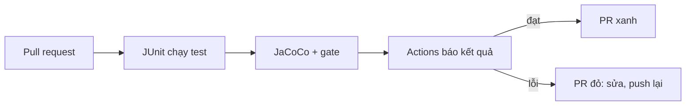
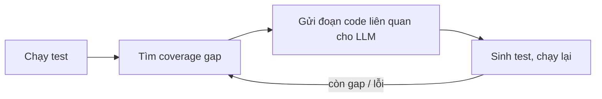
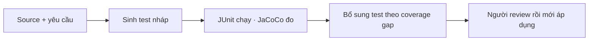

# Unit Test, Code Coverage <br> và CI/CD

Kiểm thử tự động với JUnit · JaCoCo · GitHub Actions

<div class="logos">
  
  
  
  
</div>

<!--
Mở đầu: một thay đổi nhỏ có thể làm hỏng chức năng đang chạy. Kiểm tra thủ công sau mỗi lần sửa thì tốn thời gian và khó lặp lại.
Unit Test biến các kiểm tra đó thành test chạy tự động. Bài tập trung vào Unit Test, Code Coverage, coverage gate trong CI/CD, với ba công cụ JUnit, JaCoCo, GitHub Actions.
-->

---
layout: statement
---

<p class="kicker">Câu hỏi chính</p>

# Test xanh và coverage 100% <br> có chắc chương trình đã đúng không?

<!--
Khi toàn bộ test đều xanh, ta vẫn chưa biết bộ test đã đi qua hết các nhánh hay chưa — Code Coverage trả lời phần đó. Từ coverage, nhóm tạo coverage gate để build thất bại nếu độ phủ dưới ngưỡng.
Đặt câu hỏi này cho khán giả, giữ lại câu trả lời đến cuối bài.
-->

---

# 5 video demo đi kèm

| | Nội dung | Thực hiện | Thời lượng |
|---|---|---|---|
| **A** | Unit Test với JUnit 5 & Mockito | Nguyễn Bảo An | 06:45 |
| **B** | Code Coverage & PIT Mutation Testing | Trương Nhật Đạt | 08:35 |
| **C** | Case study & 7 kịch bản HTTP | Nguyễn Lê Thế Vinh | 04:30 |
| **D** | CI/CD pipeline với GitHub Actions | Phạm Quang Vinh | 08:45 |
| **E** | AI & tái hiện thực nghiệm paper | Ngô Gia An | 09:15 |

<p class="note">Mỗi video gồm: setup · khái niệm · demo đơn giản · demo phức tạp · trường hợp công cụ không xử lý được. Tóm tắt và link nằm ở cuối từng phần.</p>

<!--
Giới thiệu nhanh 5 video demo của nhóm, tổng khoảng 38 phút. Mỗi video có timestamp rõ ràng; slide tóm tắt từng video được đặt ngay sau phần lý thuyết tương ứng.
-->

---
layout: two-cols
---

# Unit Test là gì?

- Kiểm tra **một phần nhỏ**: hàm, phương thức, lớp
- Mỗi test kiểm tra **một hành vi**
- Phát hiện lỗi sớm, sửa code an toàn hơn
- **Không thay thế** integration test

::right::

<div class="pyramid">
  <div class="p1">E2E</div>
  <div class="p2">Integration test</div>
  <div class="p3">Unit Test<small>nhiều · nhanh · rẻ</small></div>
</div>

<!--
Unit Test so sánh kết quả thực tế với kết quả mong đợi cho một đơn vị nhỏ. Phạm vi nhỏ để khi thất bại thì tìm nguyên nhân nhanh. Test phải khởi động cả ứng dụng, gọi nhiều dịch vụ, dùng DB thật thì không còn là Unit Test thuần.
Lợi ích: báo lỗi ngay khi thay đổi làm sai hành vi; refactor rồi chạy lại để kiểm tra hành vi cũ; tên test và assertion mô tả chương trình phải xử lý thế nào.
Integration test vẫn cần để xác nhận các thành phần thật kết nối đúng.
-->

---
class: code-lg
---

# Arrange · Act · Assert

```java
@Test void thuongTre3Ngay_tra6000() {
    var calculator = new FineCalculator();                  // Arrange
    var fine = calculator.calculate(3, MemberTier.NORMAL);  // Act
    assertThat(fine).isEqualByComparingTo("6000");          // Assert
}
```

<div class="mt-8 grid grid-cols-3 gap-4 text-center">
  <div class="card">Một hành vi rõ ràng</div>
  <div class="card">Nhanh, độc lập, lặp lại được</div>
  <div class="card">Assertion bám nghiệp vụ</div>
</div>

<!--
Arrange: chuẩn bị đối tượng, dữ liệu, dependency. Act: thực hiện hành vi. Assert: so sánh với kết quả mong đợi.
Assertion quyết định test có bắt được sai lệch không: kiểm tra "không rỗng" là chưa đủ nếu yêu cầu là đúng 6.000 đồng.
Test tốt: một hành vi rõ ràng, chạy nhanh, không phụ thuộc thứ tự, cùng code + dữ liệu cho cùng kết quả, tên mô tả tình huống và kết quả, và phải thất bại khi quy tắc nghiệp vụ bị làm sai. Nhiều assertion vẫn ổn nếu cùng kiểm tra một kết quả.
-->

---
layout: two-cols
---

# Chọn test case

<p class="def"><b>Test case</b> = đầu vào + điều kiện + kết quả mong đợi<br><span>Ví dụ: hạng VIP, trễ 3 ngày → phí 1.000đ</span></p>

- Trường hợp bình thường
- Giá trị biên
- Dữ liệu không hợp lệ
- Rỗng, hoặc vượt giới hạn

::right::

<div class="boundary">
  <p class="kicker">Ranh giới tại 25</p>
  <div class="nums"><span>24</span><span class="hl">25</span><span>26</span></div>
  <p>trước · tại · sau ranh giới</p>
</div>

<!--
Test case là một tình huống kiểm thử cụ thể: dữ liệu đầu vào, điều kiện thực hiện và kết quả mong đợi. Ví dụ với quy tắc VIP được miễn hai ngày đầu: hạng VIP, trễ ba ngày, phí mong đợi 1.000 đồng.
Test case xuất phát từ yêu cầu, điều kiện và giới hạn của chức năng: bình thường, giá trị biên, dữ liệu không hợp lệ, rỗng hoặc không tồn tại, đạt hoặc vượt giới hạn.
Nếu quy tắc đổi tại giá trị 25, kiểm tra 24, 25 và 26 — ngay trước, tại và sau ranh giới. Ba giá trị này bắt được lỗi dùng sai toán tử so sánh.
Khi nhiều test chỉ khác dữ liệu: data-driven testing — một test chạy với nhiều bộ đầu vào và kết quả mong đợi, giảm code lặp, giá trị biên dễ quan sát.
-->

---
layout: two-cols
---

# Mock

<div class="ctx">
  <div class="svc">Test → <code>LoanService.borrow(7, 9)</code></div>
  <div class="deps">
    <div>BookRepository<small>mock</small></div>
    <div>MemberRepository<small>mock</small></div>
    <div>LoanRepository<small>mock</small></div>
  </div>
  <div class="db"><s>Cơ sở dữ liệu thật</s> không cần</div>
</div>

- Tình huống: sách #7 **đang có người mượn**
- Mong đợi: từ chối, **không** tạo phiếu mượn

::right::

```java
// Arrange: repo giả trả về sách đã được mượn
when(books.findById(7))
    .thenReturn(Optional.of(new Book(7, false)));

// Act + Assert: bị từ chối BOOK_UNAVAILABLE
assertThatThrownBy(() -> service.borrow(7, 9))
    .isInstanceOf(LoanException.class);

// không tạo phiếu mượn
verify(loans, never()).save(any());
```
<p class="caption">Rút gọn từ <code>LoanServiceAiImprovedTest</code></p>

<p class="note">Mock khác hệ thống thật → test xanh nhưng app vẫn lỗi → luồng quan trọng cần thêm integration test</p>

<!--
Bối cảnh: LoanService.borrow cần ba repository. Nếu dùng DB thật thì muốn có tình huống "sách đang được mượn" phải chuẩn bị dữ liệu, test chậm và phụ thuộc môi trường.
Mock thay ba repository bằng đối tượng do test điều khiển: chỉ cần nói "findById(7) trả về sách không còn sẵn". Test kiểm tra hai điều: service ném lỗi BOOK_UNAVAILABLE và không gọi loans.save, tức là không tạo phiếu mượn.
Giới hạn: nếu đối tượng giả hoạt động khác repository thật, test vẫn xanh trong khi ứng dụng lỗi. Vì vậy luồng mượn sách còn có integration test chạy với Spring và H2 (Video C).
-->

---

# Framework Unit Test theo ngôn ngữ

<div class="langs">
  <div class="pick"><carbon-java class="li" /><b>Java</b>JUnit 5 · TestNG</div>
  <div><carbon-logo-python class="li" /><b>Python</b>pytest · unittest</div>
  <div><ph-file-js class="li" /><b>JavaScript / TypeScript</b>Jest · Vitest</div>
  <div><ph-file-c-sharp class="li" /><b>C# / .NET</b>xUnit · NUnit · MSTest</div>
  <div><ph-file-cpp class="li" /><b>C / C++</b>GoogleTest · Catch2</div>
  <div><ph-file-code class="li" /><b>Go</b>package <code>testing</code> có sẵn</div>
</div>

<p class="note">Case study viết bằng <b>Java</b> (Spring Boot + Maven) → nhóm chọn <b>JUnit 5</b>: phổ biến nhất cho Java, chạy sẵn qua Maven Surefire, JaCoCo đo được ngay</p>

<!--
Mỗi ngôn ngữ có framework Unit Test riêng, nhưng ý tưởng giống nhau: tìm test, chạy test, so sánh kết quả bằng assertion, báo pass/fail.
Nhóm chọn JUnit 5 vì case study viết bằng Java: Spring Boot dùng JUnit 5 mặc định, Maven Surefire chạy được ngay, JaCoCo gắn agent vào cùng lần chạy để đo coverage. TestNG cũng dùng được nhưng ít phổ biến hơn với Spring Boot.
Hai paper ở phần sau làm việc với Python nên sinh test dạng pytest.
-->

---

# JUnit 

- Framework viết và chạy test Java
- Assertion: thực tế so với mong đợi
- Parameterized test, dữ liệu từ CSV
- Tích hợp tốt Maven, Spring Boot

```java
@ParameterizedTest
@CsvFileSource(resources = "/AI-4-boundaries.csv", numLinesToSkip = 1)
void kiemDuLieuAiSinh(int days, MemberTier tier, BigDecimal expected) {
    assertThat(new FineCalculator().calculate(days, tier)).isEqualByComparingTo(expected);
}
```
<p class="caption">Một test, nhiều dòng dữ liệu từ CSV</p>

<!--
JUnit giúp test runner tìm test case, chạy từng test và ghi nhận pass/fail. Có assertion và parameterized test: một test chạy với nhiều dòng dữ liệu, ví dụ đọc từ CSV.
Nhóm chọn JUnit vì case study viết bằng Java và JUnit tích hợp tốt với Maven, Spring Boot. Trong bài, JUnit đại diện cho bước viết và chạy Unit Test — không đi sâu vào toàn bộ annotation/API.
-->

---
class: video
---

# <span class="vtag">Video A</span> Unit Test với JUnit 5 & Mockito

<div class="vbody">
<a class="play" href="https://youtu.be/5CaBhsgvM-Q" target="_blank"><carbon-play-filled-alt class="icon" /><b>Video A</b><span>06:45</span><small>Nguyễn Bảo An</small><u>youtu.be/5CaBhsgvM-Q</u></a>
<div class="tl">
  <div><time>00:00</time><em>Setup</em><span>Java 25, Maven Wrapper, <code>pom.xml</code></span></div>
  <div><time>01:00</time><em>Khái niệm</em><span>AAA, chạy test, đọc báo cáo Surefire</span></div>
  <div><time>02:15</time><em>Data-driven</em><span><code>@ParameterizedTest</code> + CSV, giá trị biên 0 / VIP 2 ngày / trần 50.000đ</span></div>
  <div><time>03:45</time><em>Phức tạp</em><span>Mockito cô lập 3 repository, <code>verify(never())</code>, <code>ArgumentCaptor</code></span></div>
  <div><time>05:15</time><em>Hạn chế</em><span>Anti-pattern: Train Wreck Mocking, Self-fulfilling Prophecy</span></div>
</div>
</div>

<!--
Video A minh họa phần Unit Test và JUnit: setup, quy tắc AAA, data-driven test với CSV, Mockito cô lập dependency và các anti-pattern khi mock.
-->

---

# Code Coverage là gì?

<div class="formula">Coverage = <span>số thành phần đã được thực thi</span> ÷ <span>tổng số thành phần đo được</span> × 100%</div>

- "Thành phần" có thể là dòng, câu lệnh, nhánh hoặc phương thức
- Nói "80%" phải nói rõ: **80% line** hay **80% branch**?
- Chạy 8/10 dòng → line 80%, nhưng `if` mới đi hướng đúng → branch vẫn thiếu

<p class="note">Coverage = code <b>đã chạy</b>, không phải code <b>đã đúng</b>: test không có assertion vẫn được tính là đã phủ</p>

<!--
Code Coverage, hay độ phủ mã nguồn, cho biết bộ test đã thực thi phần nào của chương trình. Công thức chung: số thành phần đã thực thi chia tổng số thành phần đo được. Thành phần có thể là dòng, câu lệnh, nhánh hay phương thức, nên khi nói 80% phải nói rõ là 80% line hay 80% branch.
Ví dụ một hàm có 10 dòng, test chạy qua 8 dòng thì line coverage 80%. Nhưng trong 8 dòng đó có thể có một câu if mới chạy hướng đúng, chưa chạy hướng sai — line khá cao mà branch vẫn thiếu.
Coverage trả lời ba câu hỏi: test đã đi qua đâu, dòng hoặc nhánh nào chưa kiểm tra, và thêm test thì phạm vi có tăng không. Coverage không tự đánh giá test đúng hay sai: test không có assertion vẫn được tính là đã phủ.
-->

---
class: cmp
---

# Các loại code coverage

| Loại | Câu hỏi cần trả lời | JaCoCo |
|---|---|:---:|
| Statement | Các câu lệnh đã được thực thi chưa? | <span class="eq">≈</span> |
| Line | Các dòng source đã được chạy chưa? | <span class="good">✓</span> |
| Branch / Decision | Mỗi quyết định đã đi cả hướng đúng và sai chưa? | <span class="good">✓</span> |
| Condition | Mỗi điều kiện con đã nhận cả đúng và sai chưa? | <span class="bad">✕</span> |
| MC/DC | Từng điều kiện con có tự làm đổi kết quả không? | <span class="bad">✕</span> |
| Path | Các đường đi khác nhau qua hàm đã chạy chưa? | <span class="bad">✕</span> |
| Method | Mỗi phương thức đã được gọi ít nhất 1 lần chưa? | <span class="good">✓</span> |

<p class="caption">JaCoCo không đếm câu lệnh mà đếm instruction bytecode (≈). Các slide sau dùng <b>một đoạn code chung</b> để thấy từng loại khác nhau.</p>

<!--
Có bảy loại coverage thường gặp. Statement: mỗi câu lệnh đã chạy chưa. Line: mỗi dòng source đã chạy chưa. Branch hay decision: mỗi quyết định đã đi cả hướng đúng và sai chưa. Condition: mỗi điều kiện con trong biểu thức ghép đã nhận cả đúng và sai chưa. MC/DC: từng điều kiện con có được chứng minh là tự làm đổi kết quả không, hay dùng trong hệ thống an toàn cao. Path: các tổ hợp đường đi qua hàm. Method: mỗi phương thức đã được gọi chưa, đây là chỉ số thô nhất.
Không loại nào mô tả đủ chất lượng bộ test. Line tìm dòng bị bỏ sót, branch và condition kiểm tra logic rẽ nhánh, path cho biết các nhánh kết hợp ra sao.
-->

---

# Line coverage khác Statement coverage

```java
int getDiscount(boolean isVip) {
    int discount = 0; if (isVip) discount = 10;   // 1 dòng, nhiều câu lệnh
    return discount;
}
```

| Test | Line | Statement |
|---|:---:|:---:|
| `isVip = false` → 0 | **100%** | chưa đủ: `discount = 10` chưa chạy |
| thêm `isVip = true` → 10 | 100% | **100%** |

<p class="caption">Ví dụ cố ý đặt nhiều câu lệnh trên một dòng. Code thường viết mỗi câu lệnh một dòng nên hai chỉ số hay gần nhau.</p>

<!--
Ví dụ cố ý đặt hai câu lệnh trên cùng một dòng. Test với isVip = false: dòng thứ hai vẫn chạy vì phải gán discount = 0 và kiểm tra điều kiện, dòng return cũng chạy, nên line coverage 100%.
Nhưng câu lệnh discount = 10 chưa chạy vì isVip đang sai, nên statement coverage chưa đạt 100%. Thêm test isVip = true, mong đợi 10, thì statement mới đủ.
Line quan tâm dòng code, statement quan tâm từng câu lệnh trong dòng đó.
-->

---

# Một code chung cho mọi loại coverage

<div class="ex">
<div>

```java
int calculateDiscount(boolean isMember,
                      boolean hasCoupon) {
    int discount = 0;
    if (isMember && hasCoupon) {
        discount = 20;
    }
    return discount;
}
```
<p class="caption">1 quyết định · 2 điều kiện con · 2 đường đi. Thành viên <b>và</b> có phiếu → giảm 20%.</p>

</div>
<div>

| Test | `isMember` | `hasCoupon` | Kết quả |
|---|:---:|:---:|:---:|
| T1 | true | true | 20 |
| T2 | false | true | 0 |
| T3 | true | false | 0 |
| T4 | false | false | 0 |

</div>
</div>

<!--
Để so các loại coverage trên cùng một code, nhóm dùng hàm calculateDiscount: thành viên và có phiếu giảm giá thì giảm 20%, còn lại không giảm.
Hàm có một quyết định isMember && hasCoupon, hai điều kiện con, hai đường đi là vào hoặc bỏ qua thân if.
T1 cả hai đúng. T2 isMember sai. T3 hasCoupon sai. T4 cả hai sai. Slide sau thêm lần lượt từng test.
-->

---
class: cmp
---

# Thêm từng test case: loại coverage nào tăng?

| Bộ test | Statement | Line | Decision | Condition | MC/DC | Path | JaCoCo branch |
|---|:---:|:---:|:---:|:---:|:---:|:---:|:---:|
| T1 | **100%** | **100%** | 50% | 2/4 | 0/2 | 1/2 | 50% |
| T1 + T2 | <span class="eq">=</span> | <span class="eq">=</span> | **100%** <span class="up">▲</span> | 3/4 <span class="up">▲</span> | 1/2 <span class="up">▲</span> | **2/2** <span class="up">▲</span> | 75% <span class="up">▲</span> |
| T1 + T2 + T3 | <span class="eq">=</span> | <span class="eq">=</span> | <span class="eq">=</span> | **4/4** <span class="up">▲</span> | **2/2** <span class="up">▲</span> | <span class="eq">=</span> | **100%** <span class="up">▲</span> |
| + T4 | <span class="eq">=</span> | <span class="eq">=</span> | <span class="eq">=</span> | <span class="eq">=</span> | <span class="eq">=</span> | <span class="eq">=</span> | <span class="eq">=</span> |

<p class="note">Chỉ T1 đã đủ <b>line 100%</b> nhưng branch mới 50%. T4 dùng đầu vào mới nhưng đi lại đường sai của T2 nên <b>không chỉ số nào tăng</b>.</p>
<p class="caption">JaCoCo branch chạy thật: 2/4 → 3/4 → 4/4 → 4/4. JaCoCo đếm 4 nhánh vì <code>&&</code> dịch thành 2 lệnh rẽ trong bytecode.</p>

<!--
T1 làm cả hai điều kiện đúng nên mọi dòng và câu lệnh đều chạy: statement và line 100%. Nhưng quyết định mới nhận kết quả đúng nên decision và JaCoCo branch mới 50%.
T2 làm isMember sai, bỏ qua thân if: decision và path lên 100%. Vì Java dừng ngay khi isMember sai (short-circuit) nên hasCoupon chưa được kiểm với giá trị sai, JaCoCo branch mới 75%.
T3 giữ isMember đúng, đổi hasCoupon sai: Java phải đánh giá điều kiện thứ hai. Condition, MC/DC và JaCoCo branch đạt 100%.
T4 cả hai sai: test hợp lệ nhưng đi lại đường T2 đã phủ, các chỉ số không tăng. Số test tăng từ ba lên bốn mà coverage giữ nguyên — dữ liệu khác nhau chưa chắc tạo ra dòng, nhánh hay đường đi mới.
Số JaCoCo nhóm đã chạy thật: 2/4, 3/4, 4/4, 4/4.
-->

---

# Coverage cao **không** chứng minh

- Assertion đã đúng
- Mọi giá trị biên đã kiểm tra
- Các thành phần tích hợp đúng
- Chương trình hết lỗi

<div class="vs">
  <div><span>Test A · coverage 100%</span><code>assertThat(fine).isNotNull()</code><p class="bad">✕ Không bắt được sai số tiền</p></div>
  <div><span>Test B · coverage 100%</span><code>isEqualByComparingTo("6000")</code><p class="good">✓ Bắt được sai số tiền</p></div>
</div>

<p class="kicker mt-5">Gặp coverage gap thì làm gì?</p>
<div class="gapsteps">
  <div><b>1</b>Tìm dòng / nhánh thiếu</div>
  <div><b>2</b>Tìm dữ liệu đi vào đó</div>
  <div><b>3</b>Đối chiếu yêu cầu</div>
  <div><b>4</b>Viết assertion cụ thể</div>
  <div><b>5</b>Chạy lại, đọc báo cáo</div>
</div>

<!--
Hai bộ test có thể cùng coverage nhưng khả năng phát hiện lỗi khác nhau: bộ thứ nhất kiểm tra kết quả chính xác, bộ thứ hai chỉ kiểm tra không rỗng. Cả hai chạy qua cùng dòng và nhánh, nhưng bộ thứ nhất bắt lỗi tốt hơn.
Coverage gap là phần code chưa được thực thi: dòng đỏ, nhánh chưa chạy, hoặc điều kiện con chưa nhận đủ đúng và sai. Khi gặp gap: xác định phần thiếu, đọc điều kiện để biết dữ liệu nào đi vào đó, đối chiếu yêu cầu để biết kết quả mong đợi, viết test với assertion cụ thể, rồi chạy lại và đọc báo cáo mới.
Ví dụ nhánh hasCoupon = false chưa phủ thì thêm test khách không có phiếu, kiểm tra kết quả bằng 0. Chạy qua nhánh làm coverage tăng; assertion mới xác nhận kết quả đúng.
-->

---

# JaCoCo

- JUnit chạy test, JaCoCo ghi lại **bytecode** đã được thực thi
- Báo cáo HTML: <span class="good">xanh</span> đã chạy · <span class="bad">đỏ</span> chưa chạy · <span class="warn">vàng</span> phủ một phần
- Branch đếm theo bytecode: `a && b` thành **4 nhánh**
- Đặt **ngưỡng** trong build → coverage gate


<!--
JaCoCo đo Code Coverage cho Java. JUnit chạy test và kiểm tra assertion, còn JaCoCo theo dõi phần code được thực thi trong lúc đó. Quy trình: Maven khởi động JUnit, JaCoCo ghi nhận bytecode đã chạy, tổng hợp theo package, lớp, phương thức, dòng, rồi tạo báo cáo HTML.
Màu xanh là đã chạy, đỏ là chưa, vàng là dòng có điều kiện mới phủ một phần; ở câu if báo cáo còn ghi số nhánh đã phủ.
Nhóm quan tâm line và branch. Vì JaCoCo đếm branch từ bytecode, biểu thức C1 && C2 cho 4 nhánh chứ không phải 2 như cách đếm decision ở source — đúng như ví dụ T1–T4.
JaCoCo còn kiểm tra ngưỡng trong lúc build: thấp hơn ngưỡng thì Maven báo thất bại. Đó là coverage gate.
-->

---

# Coverage gate

<div class="gate">
  <div class="ok">Branch 92% ≥ 90% → build tiếp tục</div>
  <div class="fail">Branch 85% &lt; 90% → build đỏ, dù test vẫn xanh</div>
</div>

- Case study: `FineCalculator` **branch ≥ 90%**, chỉ đặt cho lớp nghiệp vụ quan trọng
- Bắt được: thêm nhánh mới mà không thêm test, hoặc lỡ xóa test
- Gate **không** tự viết test, không biết expected và assertion đúng hay sai

```xml
<include>vn.edu.seminar.fine.FineCalculator</include>
<counter>BRANCH</counter><value>COVEREDRATIO</value><minimum>0.90</minimum>
```
<p class="caption">Luật gate trong <code>case-study/pom.xml</code></p>

<!--
Coverage gate là điều kiện trong build: đạt ngưỡng thì build tiếp tục, không đạt thì build thất bại. Ví dụ gate 90%: 92% được chấp nhận, 85% làm build đỏ — dù Unit Test vẫn xanh, vì test xanh chỉ nói các tình huống đã viết cho đúng kết quả, còn gate hỏi bộ test đã đi qua đủ nhánh chưa.
Gate phát hiện thay đổi thêm nhánh mà không thêm test, hoặc test quan trọng bị xóa. Build đỏ thì mở báo cáo, tìm nhánh thiếu, đối chiếu yêu cầu.
Không có ngưỡng chung cho mọi dự án. Nhóm đặt branch FineCalculator tối thiểu 90%, nơi sai sót ảnh hưởng trực tiếp đến tiền phí. Gate không thay review code và review test case.
-->

---
class: video
---

# <span class="vtag">Video B</span> Code Coverage & PIT Mutation Testing

<div class="vbody">
<a class="play" href="https://youtu.be/DbqXRK-PThA" target="_blank"><carbon-play-filled-alt class="icon" /><b>Video B</b><span>08:35</span><small>Trương Nhật Đạt</small><u>youtu.be/DbqXRK-PThA</u></a>
<div class="tl">
  <div><time>00:00</time><em>Setup</em><span>JaCoCo agent và PIT trong <code>pom.xml</code></span></div>
  <div><time>01:00</time><em>Khái niệm</em><span>6 loại coverage trên <code>LoanPeriodPolicy</code> (Statement, Decision, MC/DC)</span></div>
  <div><time>03:00</time><em>Đơn giản</em><span>Trước / sau: branch 50% → 100%</span></div>
  <div><time>04:00</time><em>Phức tạp</em><span>Gate fail exit 1; test bẫy 100% branch nhưng PIT chỉ diệt 3/11 mutant</span></div>
  <div><time>06:00</time><em>Hạn chế</em><span>Quyết định ẩn trong <code>Math.min()</code>, mutant tương đương, chi phí PIT</span></div>
</div>
</div>

<!--
Video B minh họa Code Coverage, JaCoCo và coverage gate. Điểm nhấn: test bẫy đạt 100% branch nhưng PIT chỉ diệt 3/11 mutant, đúng thông điệp coverage cao chưa chứng minh test tốt.
-->

---

# CI/CD với GitHub Actions



<div class="grid grid-cols-2 gap-6 items-center">
<div>

- **CI**: mỗi push / PR đều build và test
- Nhóm dừng ở **Continuous Delivery**: đóng gói, chưa tự deploy

</div>

</div>

<!--
CI: tích hợp thay đổi thường xuyên và chạy kiểm tra tự động khi có push hoặc pull request.
Continuous Delivery: tới bước tạo sản phẩm có thể phát hành. Continuous Deployment: tự triển khai lên môi trường thật. Nhóm dừng ở Delivery.
Test lỗi hoặc coverage không đạt → PR đỏ; sửa và push lại thì workflow tự chạy lại.
Ba vai trò: JUnit viết và chạy test; JaCoCo đo code đã chạy; GitHub Actions tự động hóa toàn bộ.
-->

---
class: video
---

# <span class="vtag">Video D</span> CI/CD pipeline với GitHub Actions

<div class="vbody">
<a class="play" href="https://youtu.be/vakw7UD_SvU" target="_blank"><carbon-play-filled-alt class="icon" /><b>Video D</b><span>08:45</span><small>Phạm Quang Vinh</small><u>youtu.be/vakw7UD_SvU</u></a>
<div class="tl">
  <div><time>00:00</time><em>Setup</em><span><code>ci.yml</code>, runner <code>ubuntu-latest</code>, Temurin JDK 25</span></div>
  <div><time>01:00</time><em>Khái niệm</em><span>3 job nối bằng <code>needs</code>: test → coverage-gate → package</span></div>
  <div><time>02:15</time><em>Đơn giản</em><span>Run xanh, đọc log, tải artifact JAR và Surefire report</span></div>
  <div><time>04:00</time><em>Phức tạp</em><span>PR đỏ vì thiếu coverage, branch protection chặn nút merge</span></div>
  <div><time>06:30</time><em>Hạn chế</em><span>Cache miss khi sửa <code>pom.xml</code>, runner jitter trên cloud</span></div>
</div>
</div>

<!--
Video D minh họa pipeline GitHub Actions: cấu hình workflow, 3 job, một run xanh, một PR đỏ bị chặn merge, và các sự cố thực tế như cache miss.
-->

---

# Case study: phí trả sách trễ

<div class="case">
<div>

| Trường hợp | Quy tắc |
|---|---|
| Thường | **2.000đ** / ngày trễ |
| VIP | Miễn 2 ngày đầu, rồi **1.000đ** / ngày |
| Mọi hạng | Tối đa **50.000đ** |
| Ngày âm / hạng rỗng | **Bị từ chối** |

</div>

</div>

<!--
Ứng dụng quản lý thư viện; demo tập trung vào lớp FineCalculator tính phí trả sách trễ.
Lớp này có nhiều nhánh và giá trị biên rõ ràng: hạng thành viên, thời gian miễn phí của VIP, mức trần 50.000đ, và hai loại dữ liệu không hợp lệ.
-->

---

# Demo: test xanh, build đỏ

<div class="steps">
  <div><b>1</b> Baseline: 1 test, xanh</div>
  <div><b>2</b> Bật gate 90% → build đỏ</div>
  <div><b>3</b> JaCoCo: chỉ ra nhánh thiếu</div>
  <div><b>4</b> Bộ đầy đủ → build xanh</div>
</div>

```bash
# Baseline: test xanh nhưng gate thất bại
case-study/mvnw -B -ntp -f case-study/pom.xml -Pbaseline -Dcoverage.gate.skip=false clean verify

# Bộ đầy đủ: test và gate đều thành công
case-study/mvnw -B -ntp -f case-study/pom.xml clean verify
```

<div class="bars">
  <div><span>Baseline</span><i><b class="miss" style="width:50%"></b><b class="hit" style="width:50%"></b></i><em class="bad">5/10 nhánh · 50%</em></div>
  <div><span>Bộ đầy đủ</span><i><b class="hit" style="width:100%"></b></i><em class="good">10/10 nhánh · 100%</em></div>
</div>

<!--
Khoảng 4 phút. Mở sẵn code và hai báo cáo trước/sau; nếu Maven chậm thì dùng video quay sẵn.
1. Bộ baseline chỉ kiểm tra thành viên thường trễ một ngày — xanh nhưng thiếu nhiều tình huống.
2. Chạy baseline với gate 90%: test vẫn xanh nhưng build đỏ vì coverage không đạt.
3. Mở báo cáo JaCoCo, chỉ các nhánh chưa chạy (VIP, trần, dữ liệu không hợp lệ).
4. Chạy bộ đầy đủ: có VIP, giá trị biên, dữ liệu không hợp lệ — coverage đạt, build xanh.
-->

---
class: video
---

# <span class="vtag">Video C</span> Case study & 7 kịch bản HTTP

<div class="vbody">
<a class="play" href="https://youtu.be/Wco_4852snM" target="_blank"><carbon-play-filled-alt class="icon" /><b>Video C</b><span>04:30</span><small>Nguyễn Lê Thế Vinh</small><u>youtu.be/Wco_4852snM</u></a>
<div class="tl">
  <div><time>00:00</time><em>Setup</em><span>Chạy JAR trên OpenJDK 25, dữ liệu mẫu H2 in-memory</span></div>
  <div><time>01:00</time><em>Demo</em><span>7 request curl: 201, 409 UNAVAILABLE, 404, 409 UNPAID_FINE</span></div>
  <div><time>03:30</time><em>Đối chiếu</em><span><code>LoanFlowEdgeCaseTest</code> khớp 100% kết quả HTTP thực tế</span></div>
</div>
</div>

<!--
Video C chạy ứng dụng thư viện thật và gửi 7 request HTTP, sau đó đối chiếu với test tự động LoanFlowEdgeCaseTest.
-->

---

# Bài tập cho người nghe

<div class="todo">
  <carbon-edit class="i" />
  <b>Đang chờ thành viên phụ trách bổ sung</b>
  <span>Link repository · file đề bài · màn hình code minh họa</span>
</div>

<!--
ĐỂ TRỐNG: thành viên phụ trách phần bài tập sẽ bổ sung link repository, đề bài và màn hình code minh họa vào slide này.
-->

---
layout: section
---

<p class="kicker">Research paper</p>

# Nghiên cứu về sinh Unit Test tự động

Hai công trình đã công bố, chạy lại bằng source code của tác giả. <br>
Thử nghiệm AI riêng của nhóm nằm ở phần sau, tách biệt với hai paper này.

<!--
Phần này trình bày hai công trình nghiên cứu đã công bố về sinh Unit Test tự động. Nhóm không tự cài đặt lại paper mà dùng source của tác giả: chạy lại kết quả công bố, rồi thử trên code thực tế của nhóm.
Đây không phải tính năng AI của nhóm; quy trình AI riêng của nhóm cho Java được trình bày sau, như một thử nghiệm độc lập.
-->

---

# Paper 2023 · Pynguin: thuật toán tìm kiếm

<p class="cite">Lukasczyk, Kroiß & Fraser, <i>An empirical study of automated unit test generation for Python</i> <span class="rank">EMSE 2023 · CORE A</span></p>

- **Không dùng LLM**: thuật toán tìm kiếm + thông tin kiểu dữ liệu + kết quả thực thi
- Chạy hoàn toàn trên máy, **không tốn token**
- Assertion chỉ ghi lại output hiện tại, không biết kết quả đúng

<div class="stats">
  <div><span>Nhóm chạy lại trên 1 module benchmark</span><b>81,48%</b><small>coverage nội bộ của Pynguin · 10 test pass, 5 xfail</small></div>
  <div><span>Thử trên source có filesystem và XML</span><b>Ít test hữu ích</b><small>thiếu assertion có ý nghĩa</small></div>
</div>

<!--
Trình bày theo năm xuất bản để không nhầm "paper thứ nhất, thứ hai" với các bước AI của nhóm.
Paper 2023 của Lukasczyk, Kroiß và Fraser đăng trên tạp chí Empirical Software Engineering. Venue hạng A theo bảng CORE2020 — đây là hạng lịch sử của venue, không phải hạng riêng của paper.
Paper nghiên cứu Pynguin: dùng thuật toán tìm kiếm, thông tin kiểu dữ liệu và kết quả thực thi để tạo test Python, không dùng mô hình ngôn ngữ, chạy trên máy nên không tốn token.
Nhóm chạy trên một module benchmark: coverage nội bộ 81,48%, 10 test pass và 5 test xfail. Thử trên source có filesystem và XML thì Pynguin tạo được ít test hữu ích và thiếu assertion có ý nghĩa.
-->

---

# Paper 2025 · CoverUp: LLM theo coverage gap

<p class="cite">Pizzorno & Berger, <i>CoverUp: Effective High Coverage Test Generation for Python</i> <span class="rank">FSE 2025 · CORE A* (CORE2023)</span></p>



<div class="stats">
  <div><span>Kết quả paper · nhóm phân tích lại dữ liệu công bố</span><b>89,0%</b><small>line + branch gộp, 163 module · MuTAP chỉ 76,8%</small></div>
  <div><span>Mô hình ngôn ngữ</span><b>GPT-4o → Gemini 3.6</b><small>paper gốc dùng GPT-4o · nhóm dùng Gemini 3.6 Flash, ≈ 0,03 USD / lượt</small></div>
</div>

<!--
Paper 2025 của Pizzorno và Berger công bố tại FSE 2025 (PACMSE). FSE hạng A* theo CORE2023, cũng là hạng của venue.
CoverUp chạy test, tìm phần source chưa phủ rồi gửi đúng đoạn code liên quan cho mô hình ngôn ngữ. Test mới được chạy và đo lại; nếu còn gap thì tiếp tục sinh hoặc sửa test theo phản hồi coverage.
Nhóm phân tích lại dữ liệu tác giả công bố: 89,0% line+branch gộp trên 163 module, cao hơn MuTAP 76,8%.
Mô hình: paper gốc dùng GPT-4o qua cloud; nhóm dùng Gemini 3.6 Flash, công cụ ước tính khoảng 0,03 USD một lượt. Kết quả phụ thuộc mô hình; nhóm chưa đo với mô hình local.
-->

---
class: cmp
---

# Cùng code, cùng thước đo: 2023 vs 2025

<p class="caption mb-3">File Python <code>scripts/coverage_gaps.py</code> của nhóm · đo bằng SlipCover source line / branch · cùng xuất phát từ 1 smoke test</p>

| | Baseline | Paper 2023 · Pynguin có seed | Paper 2025 · CoverUp + Gemini |
|---|:---:|:---:|:---:|
| Test sinh được | 1 smoke test | 2 pass, không assertion | 7 pass |
| Line | 28,2% (11/39) | 28,2% (11/39) | **97,4% (38/39)** |
| Branch | 12,5% (2/16) | 12,5% (2/16) | **93,8% (15/16)** |
| Line + branch gộp | 23,6% | 23,6% | **96,4%** |

<p class="note">Một lần thử trên một module, cấu hình và ngân sách khác nhau: <b>chưa đủ</b> kết luận CoverUp luôn tốt hơn. Hai tool chỉ hỗ trợ Python nên không chạy trực tiếp trên code Java; nhóm không gán kết quả Python thành kết quả Java.</p>

<!--
CoverUp và Pynguin đều là tool cho Python, nên artifact gốc không chạy trực tiếp trên code Java của case study. Để so sánh công bằng hơn, nhóm chạy cả hai trên cùng file scripts/coverage_gaps.py và đo bằng SlipCover line và branch, cùng xuất phát từ một smoke test.
Pynguin có seed: 2 test pass nhưng không có assertion, coverage không tăng. CoverUp với Gemini: 7 test pass, line 97,4%, branch 93,8%, gộp 96,4%. Lý do có thể thấy: hàm cần đọc file XML; LLM đọc code nên viết được file mẫu hợp lệ, còn tìm kiếm ngẫu nhiên khó tạo XML đúng cấu trúc.
Đây là một lần thử có giới hạn trên một module, không phải benchmark đủ để kết luận CoverUp luôn tốt hơn. Muốn so sánh trực tiếp trên Java phải chọn thêm công cụ sinh test Java hoặc thay paper.
-->

---

# Vì sao dừng ở 38/39 dòng và 15/16 nhánh?

<div class="vs">
  <div><span>Giả thuyết 1 · công cụ chưa đủ mạnh</span>LLM chưa nghĩ ra test cho phần còn lại</div>
  <div><span>Giả thuyết 2 · code không thể vào từ Unit Test</span>Không ai viết được Unit Test chạy tới đó</div>
</div>

```python
if __name__ == "__main__":   # nhánh còn thiếu
    main()                   # dòng còn thiếu
```

- Kết luận: **giả thuyết 2**. Test **import** module nên `__name__` không bao giờ là `"__main__"`
- Phần thiếu là entrypoint CLI, không thuộc logic `extract()` mà Unit Test nhắm tới
- Nhóm giữ nguyên 38/39 và 15/16, không thêm test chỉ để làm đẹp con số

<!--
Khi công cụ không đạt 100% có hai khả năng: công cụ chưa đủ mạnh, hoặc code có phần mà Unit Test không thể chạy tới.
Trường hợp này là khả năng thứ hai. Phần thiếu là dòng main() trong khối if __name__ == "__main__". Test import module để kiểm các hàm, nên __name__ không bằng "__main__"; dòng main() và nhánh đi vào nó không chạy. Muốn phủ phải chạy file như chương trình dòng lệnh, ví dụ bằng subprocess — đó không còn là Unit Test.
Khoảng trống thuộc entrypoint CLI, không nằm trong logic extract() mà Unit Test nhắm tới. Nhóm giữ nguyên kết quả thay vì thêm test chỉ để làm đẹp con số.
Khả năng thứ nhất vẫn có thật ở chỗ khác: trên 163 module của paper, CoverUp chỉ đạt 89,0%.
-->

---
layout: section
---

<p class="kicker">Áp dụng của nhóm</p>

# Áp dụng AI vào quy trình Java

Dùng ý tưởng của <b>Paper 2025</b>: coverage làm phản hồi, trên <code>FineCalculator</code> với JUnit + JaCoCo. <br>
Các giai đoạn gọi theo chức năng để không nhầm với tên paper. Không phải cài đặt lại CoverUp.

<!--
Nhóm áp dụng ý tưởng dùng coverage làm phản hồi của Paper 2025 trên FineCalculator, bằng JUnit và JaCoCo. Để tránh nhầm với tên paper, các giai đoạn được gọi theo chức năng: sinh test nháp, rồi bổ sung test theo coverage gap.
-->

---

# Sinh test nháp → bổ sung theo coverage gap



<p class="kicker mt-8">Vì sao vẫn cần con người review</p>
<div class="risks">
  <div><carbon-warning-alt /> Sai expected result</div>
  <div><carbon-warning-alt /> Assertion yếu</div>
  <div><carbon-warning-alt /> Trùng test hiện có</div>
</div>

<!--
Quy trình: đưa source và yêu cầu cho Gemini để sinh test nháp; JUnit chạy, JaCoCo đo coverage; Gemini nhận thêm báo cáo để bổ sung test theo coverage gap; người thực hiện review rồi mới áp dụng.
AI đề xuất test nhanh hơn, nhưng output vẫn có thể sai expected result, dùng assertion yếu hoặc trùng test hiện tại. Coverage giúp AI tìm gap; người review chịu trách nhiệm về nghiệp vụ.
-->

---

# Demo AI trên `FineCalculator`

<div class="fact">
  <span>70%</span><em>→</em><span class="hl">100%</span>
</div>
<p class="center-label">branch coverage của lượt demo (quay sẵn)</p>

- Sinh test nháp: Gemini viết 3 test, chạy xanh nhưng branch chỉ 70%
- Bổ sung theo coverage gap: thêm ngày âm, hạng rỗng, nhánh VIP còn thiếu
- Người thực hiện kiểm tra input, expected, assertion trước khi nhận

<!--
Demo quay sẵn để không phụ thuộc mạng và hạn mức API.
Gemini nhận source và quy tắc tính phí, sinh ba test nháp. Các test chạy xanh nhưng branch chỉ 70%. Gemini nhận thêm báo cáo JaCoCo, đề xuất test cho ngày âm, hạng thành viên rỗng và nhánh VIP còn thiếu. Sau khi bổ sung, branch của lượt demo đạt 100%. Người thực hiện kiểm tra input, expected result và assertion trước khi chấp nhận test.
-->

---
class: video
---

# <span class="vtag">Video E</span> AI & tái hiện thực nghiệm paper

<div class="vbody">
<a class="play" href="https://youtu.be/fLtNeE-MSw4" target="_blank"><carbon-play-filled-alt class="icon" /><b>Video E</b><span>09:15</span><small>Ngô Gia An</small><u>youtu.be/fLtNeE-MSw4</u></a>
<div class="tl">
  <div><time>00:00</time><em>Setup</em><span>Gemini Client; phân biệt Codex và Gemini API</span></div>
  <div><time>01:30</time><em>Đơn giản</em><span>Sinh test nháp, rồi bổ sung theo coverage gap</span></div>
  <div><time>03:45</time><em>Hạn chế</em><span>Bot AI review PR; ca oracle sai cho thấy giới hạn LLM</span></div>
  <div><time>05:30</time><em>Data-driven</em><span>Đối chứng dữ liệu biên: người lập vs Gemini sinh</span></div>
  <div><time>07:15</time><em>Paper</em><span>Tái hiện CoverUp (FSE 2025), so sánh Pynguin (EMSE 2023)</span></div>
</div>
</div>

<!--
Video E minh họa quy trình AI của nhóm và phần tái hiện hai paper. Ca oracle sai cho thấy vì sao con người vẫn phải review.
-->

---

# Kết luận

- **Unit Test**: dữ liệu phù hợp, assertion cụ thể
- **Coverage + gate**: tìm và chặn phần bị bỏ sót
- **GitHub Actions**: chạy tự động mỗi thay đổi
- **AI**: đề xuất test, người vẫn phải review

<div v-click class="answer">
  Test xanh + coverage 100% <b>vẫn chưa đủ</b> để kết luận chương trình đúng.
  <br>Chất lượng test nằm ở test case, assertion và yêu cầu nghiệp vụ.
</div>

<!--
Tóm lại: Unit Test kiểm tra hành vi từng phần nhỏ; Coverage cho biết test đã chạy qua đâu; gate chặn build không đạt ngưỡng; GitHub Actions tự động hóa trên mỗi thay đổi; AI đọc gap và đề xuất test nhưng người thực hiện vẫn kiểm tra expected và assertion.
Trả lời câu hỏi ban đầu (click): chưa đủ. Coverage giúp tìm phần code bị bỏ sót; chất lượng test phụ thuộc vào test case, assertion và yêu cầu nghiệp vụ.
-->

---
layout: center
class: text-center
---

# Hỏi đáp

Cảm ơn thầy cô và các bạn đã lắng nghe

<!--
Câu hỏi dự kiến:
- Có nên đặt coverage 100%? Không nhất thiết; ngưỡng dựa trên mức quan trọng và khả năng kiểm thử của từng phần.
- Coverage cao thay review test được không? Không; vẫn phải kiểm tra dữ liệu, assertion và liên hệ với yêu cầu.
- Vì sao gate chỉ cho FineCalculator? Lớp nhiều quy tắc, giá trị biên rõ; gate theo lớp giúp tập trung vào code nghiệp vụ quan trọng.
- Công cụ sinh test thay người viết test được không? Chưa; nó tạo input và tăng coverage, nhưng con người xác định kết quả đúng và kiểm tra assertion.
-->

---
class: refs
---

# Tài liệu tham khảo

- Pizzorno & Berger, *CoverUp: Effective High Coverage Test Generation for Python*, FSE 2025 — doi.org/10.1145/3729398
- Lukasczyk, Kroiß & Fraser, *An empirical study of automated unit test generation for Python*, EMSE 2023 — doi.org/10.1007/s10664-022-10248-w
- JUnit User Guide — docs.junit.org
- JaCoCo Documentation — jacoco.org/jacoco/trunk/doc
- CORE2023 (FSE) · CORE2020 (Empirical Software Engineering) — portal.core.edu.au
- GitHub Actions: Java with Maven — docs.github.com/actions
